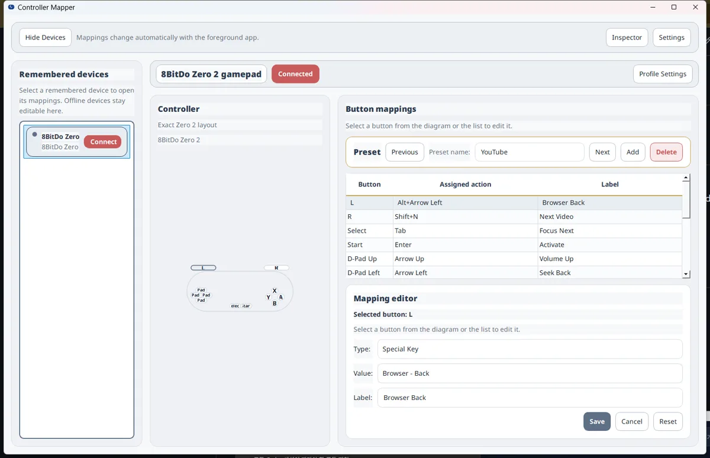
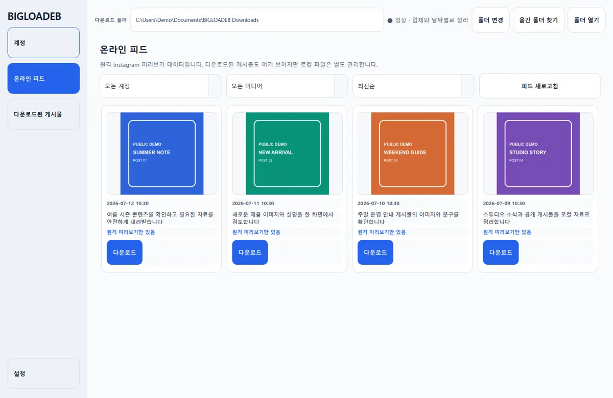

# Hi, I'm Bum-Boo

[English](README.md) | [한국어](docs/readme/README.ko.md)

I make tools that let people who don't write code get real work done with AI, robots and their own computer.
Most of them run on your machine and ask before they change anything.

## ssok

Snap parts together, wire the servos, write a few lines of code (or use blocks) and press Run.
A robotics workshop for learning, made in Godot. It runs in the browser.

**[Play in the browser](https://bum-boo.github.io/ssok/)** · [Source](https://github.com/Bum-Boo/ssok) · [Download v0.2.0](https://github.com/Bum-Boo/ssok/releases/tag/v0.2.0)

## Desktop tools

<table>
  <tr>
    <td width="50%" valign="top">
      
      <h3><a href="https://github.com/Bum-Boo/BBCC">BBCC</a></h3>
      
Turn a small game controller into a shortcut pad. It notices which app is in front and switches mappings, so the same buttons control YouTube in one app and your editing shortcuts in another.

    </td>
    <td width="50%" valign="top">
      
      <h3><a href="https://github.com/Bum-Boo/BIGLOADER-with-Ai-agent">BIGLOADER</a></h3>
      
Collect public Instagram posts from the accounts a team follows and save them into tidy local folders. Built for office staff who aren't comfortable with tech, with a CLI so an agent can run it too.

    </td>
  </tr>
</table>

Also: [Naver Cafe Posts Downloader](https://github.com/Bum-Boo/Naver-Cafe-Posts-Downloader) keeps Naver Cafe posts you can read as offline pages, and [BB TxT](https://github.com/Bum-Boo/BBTxT) searches text across a folder fast.

## AI agents

- [**kakaotalk-local-mcp**](https://github.com/Bum-Boo/kakaotalk-local-mcp): connect KakaoTalk for Windows to Claude or Codex. Only the rooms you allow, and replies wait for your approval.
- [**agent-change-gate**](https://github.com/Bum-Boo/agent-change-gate): an Obsidian plugin where the agent proposes an edit and you see the diff before it is written.
- [**hermes-comfyui-maker**](https://github.com/Bum-Boo/hermes-comfyui-maker): run ComfyUI image workflows from Telegram or Discord through Hermes Agent.
- [**hermes-desktop-korean**](https://github.com/Bum-Boo/hermes-desktop-korean): Korean translation for Hermes Desktop.
- [**Vaultwright**](https://github.com/Bum-Boo/Vaultwright): lets Codex review an Obsidian vault without editing your notes.
- [**hermes-skill-library**](https://github.com/Bum-Boo/hermes-skill-library): a curated set of skills for Hermes Agent, grouped by purpose.

## Home and Linux

- [**calmhome-sensor**](https://github.com/Bum-Boo/calmhome-sensor): know whether someone is in the room, or hasn't moved for a while, using radar instead of cameras. Home Assistant + ESPHome.
- [**frieren-os**](https://github.com/Bum-Boo/frieren-os): my Arch Linux + KDE Plasma desktop, built as a bootable ISO.

## Elsewhere

[YouTube](https://www.youtube.com/@Bum_boo-b8k) · [bumboo.fun](https://bumboo.fun) · [Live Lab](https://bum-boo.github.io/Bum-Boo/), an interactive index of earlier experiments
