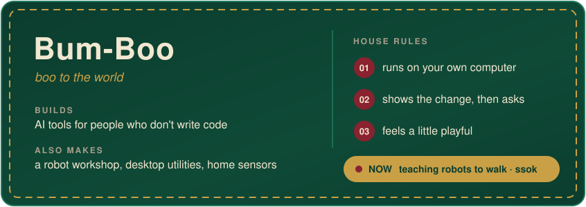
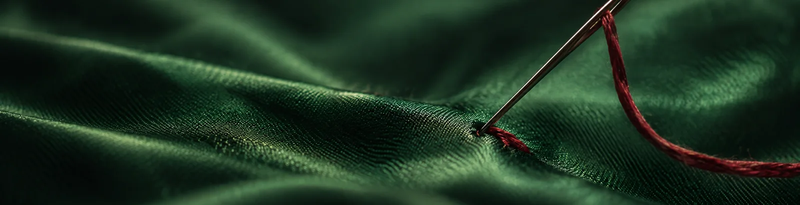
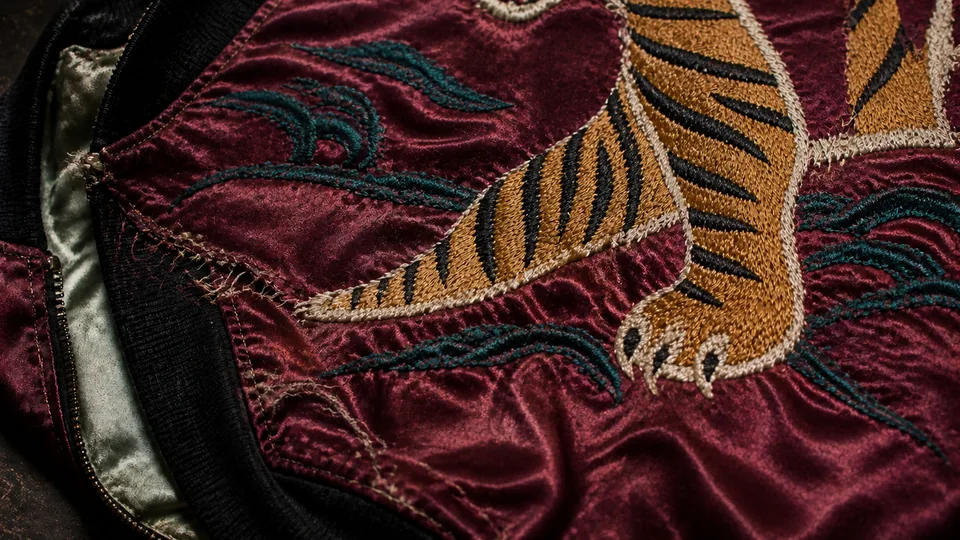
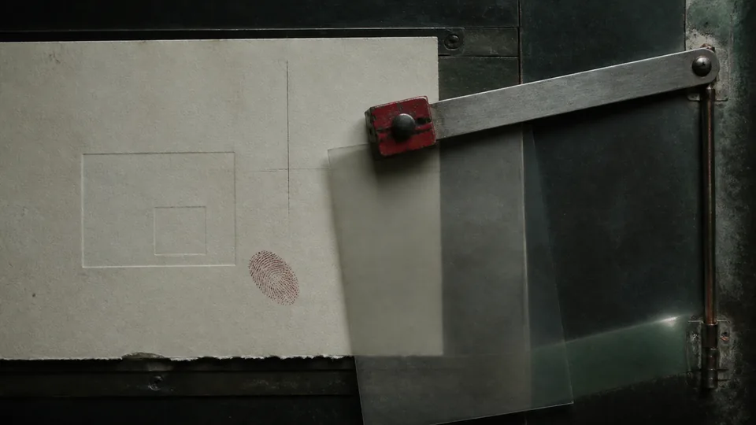
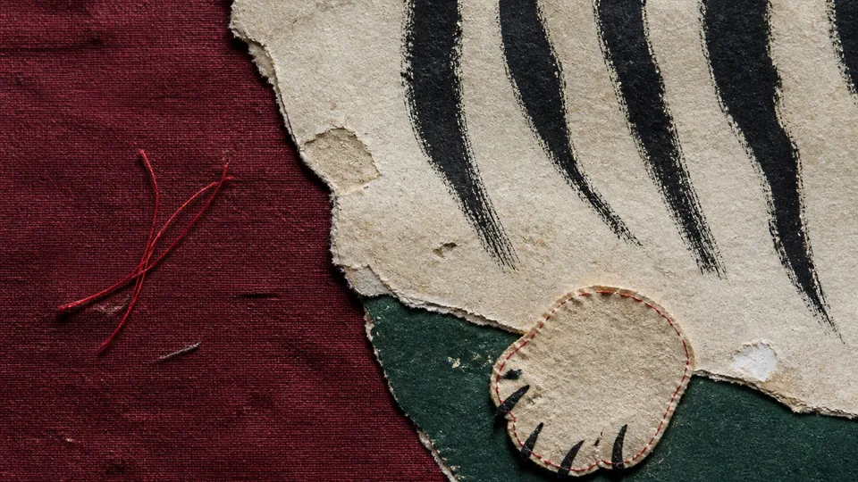
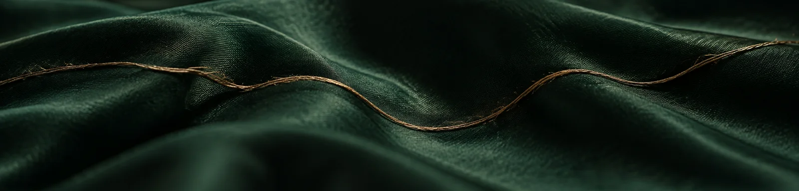
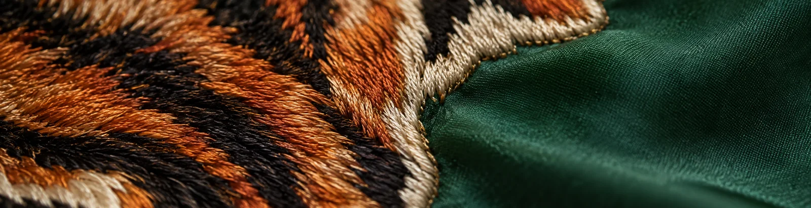

  

  

  
  
  

## About me

- I like turning a fiddly, repeated chore into one button or one sentence.
- Most of my tools sit between a person and an AI agent and keep the human in charge.
- Local first: your files live on your machine, and you choose what goes to an AI provider.
- If something here saves you time, a star is the nicest way to say hi.

## What I'm building

<b><a href="https://bum-boo.github.io/ssok/">Play ssok in your browser</a></b>: snap parts together, wire the servos, write a few lines and press Run.

  
  
  
  
  
  

<b>More from the drawer</b>

 

| | |
|---|---|
| [hermes-skill-library](https://github.com/Bum-Boo/hermes-skill-library) | Skills for Hermes Agent, grouped by purpose. |
| [frieren-os](https://github.com/Bum-Boo/frieren-os) | My Arch Linux and KDE Plasma desktop as a bootable ISO. |
| [mp32json](https://github.com/Bum-Boo/mp32json) | Turns audio into per-frame JSON for web visualizers. |
| [BTS_sec](https://github.com/Bum-Boo/BTS_sec) | Defensive audit toolkit for web and local projects you are allowed to test. |

## From the Live Lab

  
  
  

<b><a href="https://bum-boo.github.io/Bum-Boo/">Open the Live Lab</a></b>: scroll-driven experiments with paper, thread and tigers.

## Tools I reach for

  

  
  
  
  
  
  
  

## Activity

  
  

  <picture>
    <source media="(prefers-color-scheme: dark)" srcset="https://raw.githubusercontent.com/Bum-Boo/Bum-Boo/output/snake-dark.svg" />
    <source media="(prefers-color-scheme: light)" srcset="https://raw.githubusercontent.com/Bum-Boo/Bum-Boo/output/snake-light.svg" />
    
  </picture>

## Say hi

  
  
  
  

<i>Star a repo if you like it. It makes the tiger happy.</i>

  

