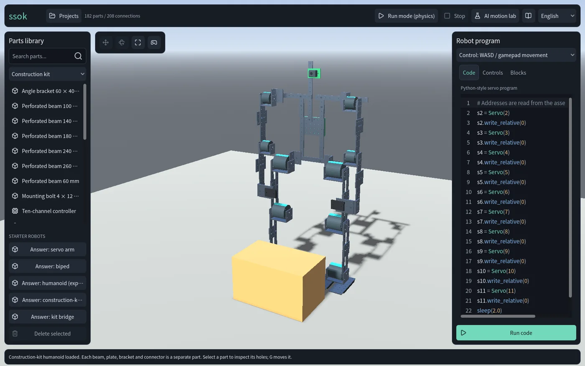

<a href="README.md">English</a> | <a href="docs/readme/README.ko.md">한국어</a>

I make AI tools for people who don't write code, plus small utilities I wanted for myself.
Most of them run on your own computer and ask before they change anything.

## ssok

Snap parts together, wire the servos, write a few lines (or use blocks) and press Run.
A robotics workshop made in Godot that runs in the browser.
**[Play it in the browser](https://bum-boo.github.io/ssok/)** or [read the source](https://github.com/Bum-Boo/ssok).

## Desktop tools

- **[BBCC](https://github.com/Bum-Boo/BBCC)** turns a small game controller into a shortcut pad that switches with the app in front.
- **[BIGLOADER](https://github.com/Bum-Boo/BIGLOADER-with-Ai-agent)** saves public Instagram posts into tidy local folders. I made it for office staff.
- **[Naver Cafe Posts Downloader](https://github.com/Bum-Boo/Naver-Cafe-Posts-Downloader)** keeps cafe posts you can read as offline pages.
- **[BB TxT](https://github.com/Bum-Boo/BBTxT)** searches text across a folder, fast.

## Agents and home

- **[kakaotalk-local-mcp](https://github.com/Bum-Boo/kakaotalk-local-mcp)** lets Claude read the KakaoTalk rooms you allow. Replies wait for your approval.
- **[agent-change-gate](https://github.com/Bum-Boo/agent-change-gate)** is an Obsidian plugin that shows the agent's edit as a diff before writing it.
- **[calmhome-sensor](https://github.com/Bum-Boo/calmhome-sensor)** tells you whether someone is in the room, or still for too long, with radar instead of cameras.
- **[hermes-comfyui-maker](https://github.com/Bum-Boo/hermes-comfyui-maker)** takes an image request from Telegram or Discord and answers from your own GPU.
- **[Vaultwright](https://github.com/Bum-Boo/Vaultwright)** lets Codex review an Obsidian vault without editing your notes.
- **[frieren-os](https://github.com/Bum-Boo/frieren-os)** is my Arch Linux and KDE Plasma desktop, built as a bootable ISO.

Elsewhere: [YouTube](https://www.youtube.com/@Bum_boo-b8k), [bumboo.fun](https://bumboo.fun)
