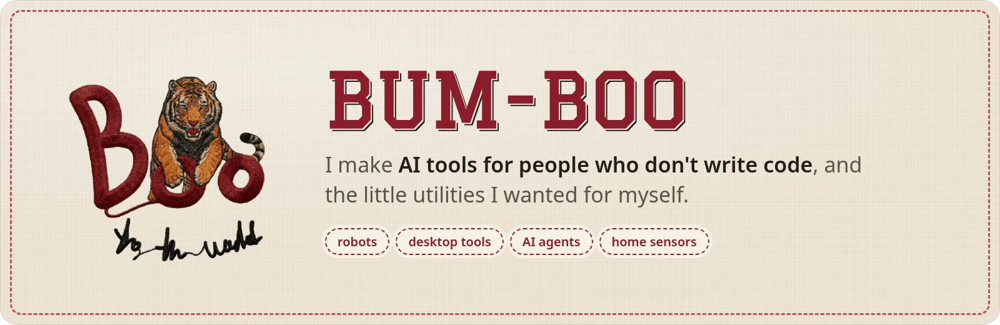
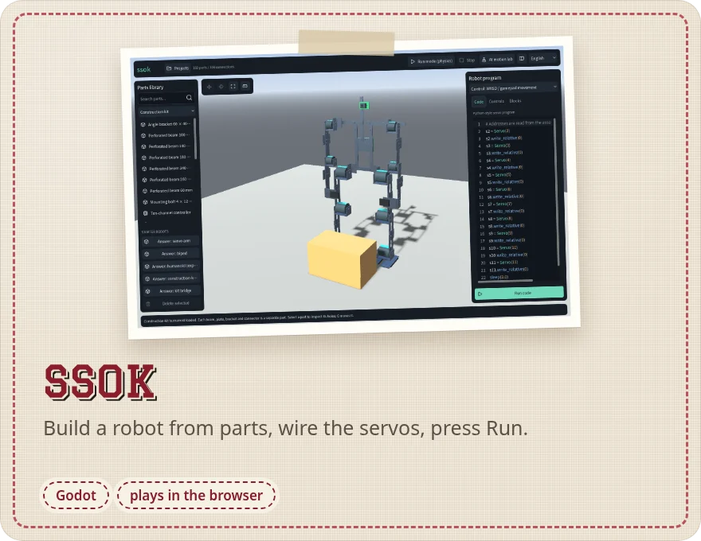
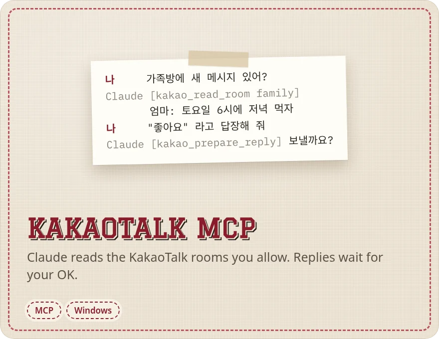
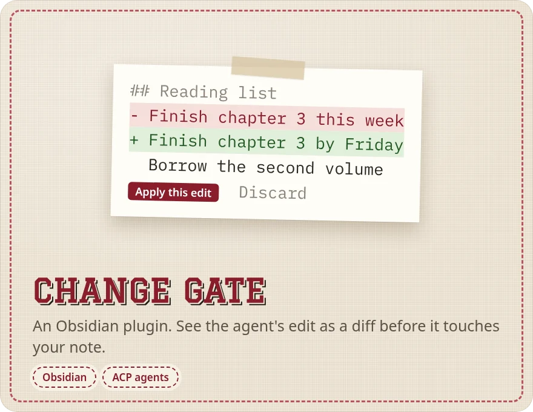
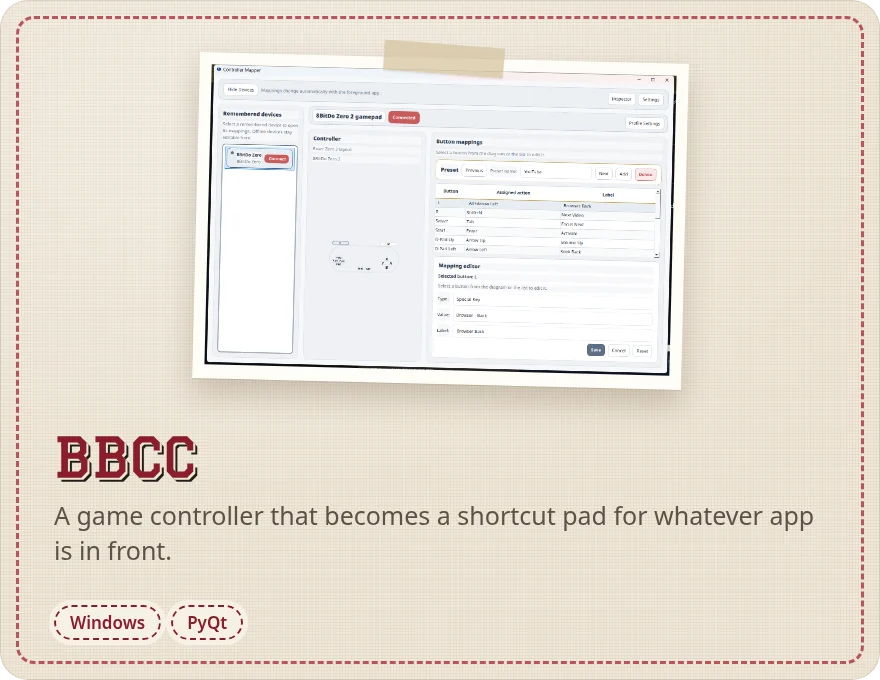
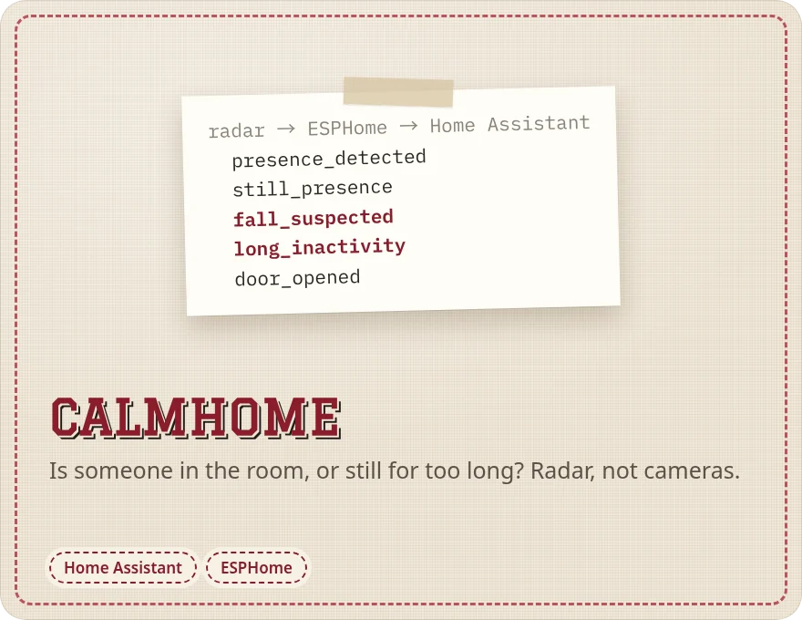
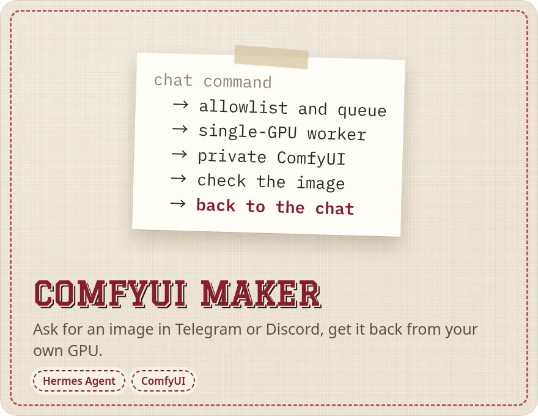

<a href="../../README.md">English</a> · <a href="README.ko.md">한국어</a>

코드를 몰라도 쓸 수 있는 AI 도구와, 제가 필요해서 만든 작은 프로그램들이에요.

## 작업대 위에 있는 것

**[브라우저에서 쏙 해 보기 →](https://bum-boo.github.io/ssok/)**

## 서랍 속 도구

| 도구 | 하는 일 |
|---|---|
| [BIGLOADER](https://github.com/Bum-Boo/BIGLOADER-with-Ai-agent) | 인스타그램 공개 게시물을 계정별, 날짜별 폴더에 저장해요. 사무실 직원분용으로 만들었어요. |
| [네이버 카페 글 보관함](https://github.com/Bum-Boo/Naver-Cafe-Posts-Downloader) | 읽을 수 있는 카페 글을 내 PC에 저장해 두고 오프라인으로 봐요. |
| [BB TxT](https://github.com/Bum-Boo/BBTxT) | 폴더 안의 글자를 빠르게 찾아요. |
| [Vaultwright](https://github.com/Bum-Boo/Vaultwright) | Codex가 옵시디언 볼트를 살펴보되 기존 노트는 건드리지 않아요. |
| [hermes-desktop-korean](https://github.com/Bum-Boo/hermes-desktop-korean) | Hermes Desktop 한국어 번역이에요. |
| [hermes-skill-library](https://github.com/Bum-Boo/hermes-skill-library) | Hermes Agent용 스킬을 쓰임새별로 모았어요. |
| [frieren-os](https://github.com/Bum-Boo/frieren-os) | 제가 쓰는 Arch Linux + KDE Plasma 데스크톱을 부팅 가능한 ISO로 만들었어요. |

[유튜브](https://www.youtube.com/@Bum_boo-b8k) · [bumboo.fun](https://bumboo.fun) · [Live Lab](https://bum-boo.github.io/Bum-Boo/)
