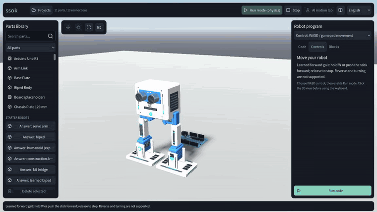
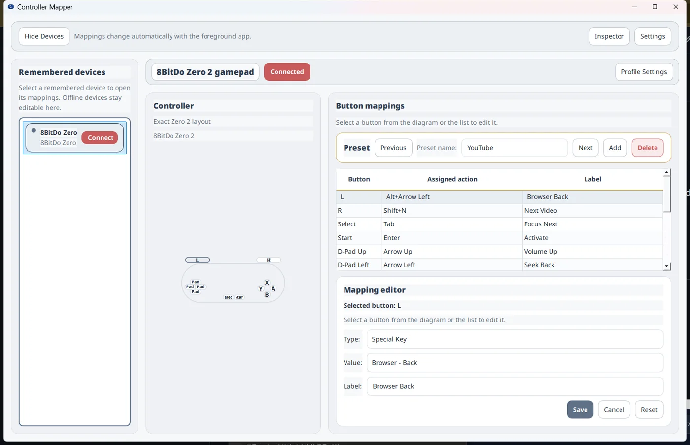
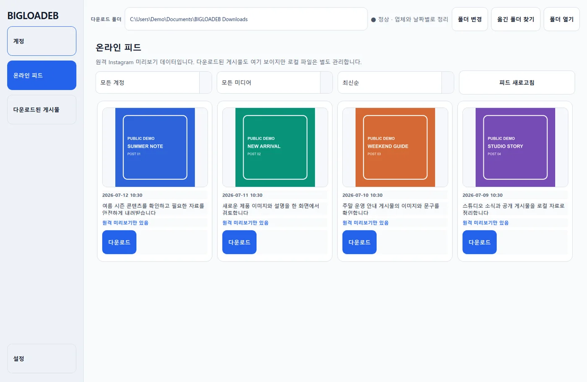

<a href="../../README.md">English</a> | <a href="README.ko.md">한국어</a>

코드를 몰라도 쓸 수 있는 AI 도구와, 제가 필요해서 만든 작은 프로그램들이에요.
대부분 내 컴퓨터에서 돌아가고, 무언가 바꾸기 전에 먼저 물어봐요.

## 제가 만들고 싶은 것

- **호랑이 발과 로봇 손.** 코드를 몰라도 집어 들고 쓸 수 있는 AI.
- **연필과 체크 표시.** 바꾸기 전에 무엇을 바꿀지 먼저 보여 주고 허락을 기다려요.
- **불 켜진 창.** 내 컴퓨터에서 돌아가고, 내 데이터는 집에 그대로 있어요.

## 쏙 (ssok)

부품을 끼워 로봇을 만들고 서보를 연결한 다음, 코드 몇 줄(또는 블록)을 짜서 실행해 보세요.
Godot로 만든 로봇 공작실이고 브라우저에서 바로 열려요. 위 영상은 학습된 걸음새를 W 키로 움직이는 장면이에요.
**[브라우저에서 해 보기](https://bum-boo.github.io/ssok/)** 또는 [소스 보기](https://github.com/Bum-Boo/ssok).

## 데스크톱 도구

- **[BBCC](https://github.com/Bum-Boo/BBCC)**: 작은 게임 패드를 단축키 패드로 써요. 앞에 떠 있는 앱에 맞춰 버튼 설정이 바뀌어요.
- **[BIGLOADER](https://github.com/Bum-Boo/BIGLOADER-with-Ai-agent)**: 인스타그램 공개 게시물을 계정별, 날짜별 폴더에 저장해요. 사무실 직원분용으로 만들었어요.
- **[네이버 카페 글 보관함](https://github.com/Bum-Boo/Naver-Cafe-Posts-Downloader)**: 읽을 수 있는 카페 글을 내 PC에 저장해 두고 오프라인으로 봐요.
- **[BB TxT](https://github.com/Bum-Boo/BBTxT)**: 폴더 안의 글자를 빠르게 찾아요.

## 에이전트와 집

- **[kakaotalk-local-mcp](https://github.com/Bum-Boo/kakaotalk-local-mcp)**: 허락한 카톡방만 Claude가 읽어요. 답장은 내가 승인해야 보내져요.
- **[agent-change-gate](https://github.com/Bum-Boo/agent-change-gate)**: 에이전트가 고칠 내용을 먼저 비교 화면으로 보여 주는 옵시디언 플러그인이에요.
- **[calmhome-sensor](https://github.com/Bum-Boo/calmhome-sensor)**: 카메라 없이 레이더로 방에 사람이 있는지, 오래 움직이지 않는지 알려 줘요.
- **[hermes-comfyui-maker](https://github.com/Bum-Boo/hermes-comfyui-maker)**: 텔레그램이나 디스코드에서 부탁하면 내 GPU로 그린 이미지를 받아요.
- **[Vaultwright](https://github.com/Bum-Boo/Vaultwright)**: Codex가 옵시디언 볼트를 살펴보되 기존 노트는 건드리지 않아요.
- **[frieren-os](https://github.com/Bum-Boo/frieren-os)**: 제가 쓰는 Arch Linux와 KDE Plasma 데스크톱을 부팅 가능한 ISO로 만들었어요.

다른 곳: [유튜브](https://www.youtube.com/@Bum_boo-b8k), [bumboo.fun](https://bumboo.fun)
